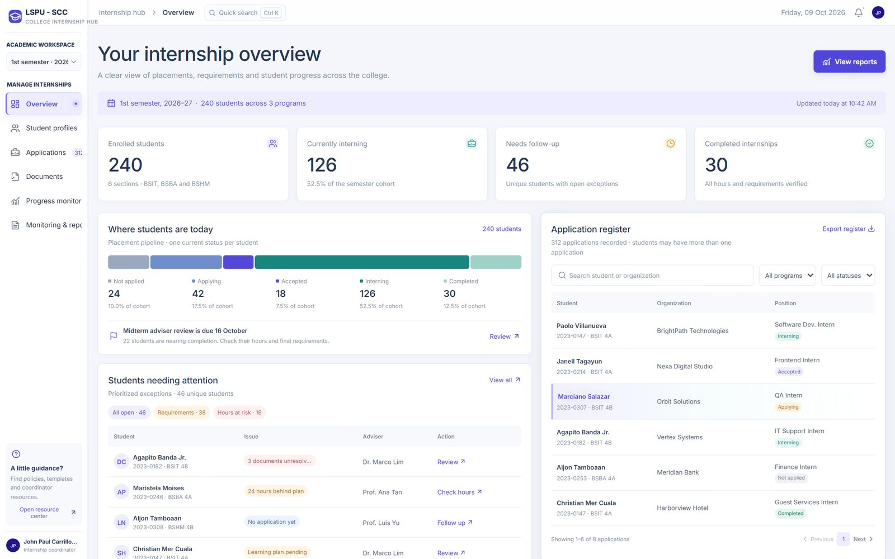
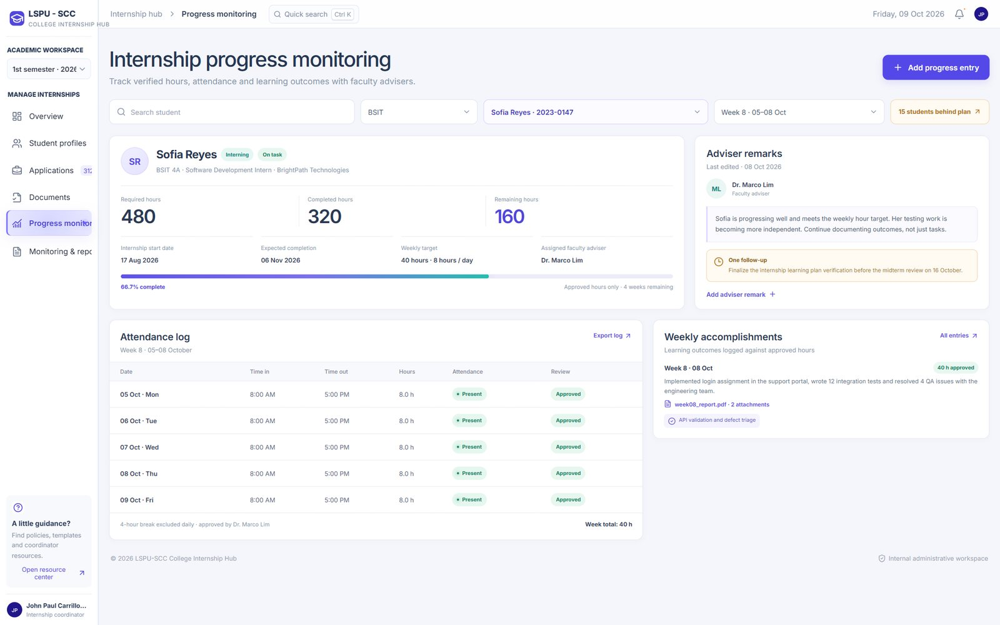
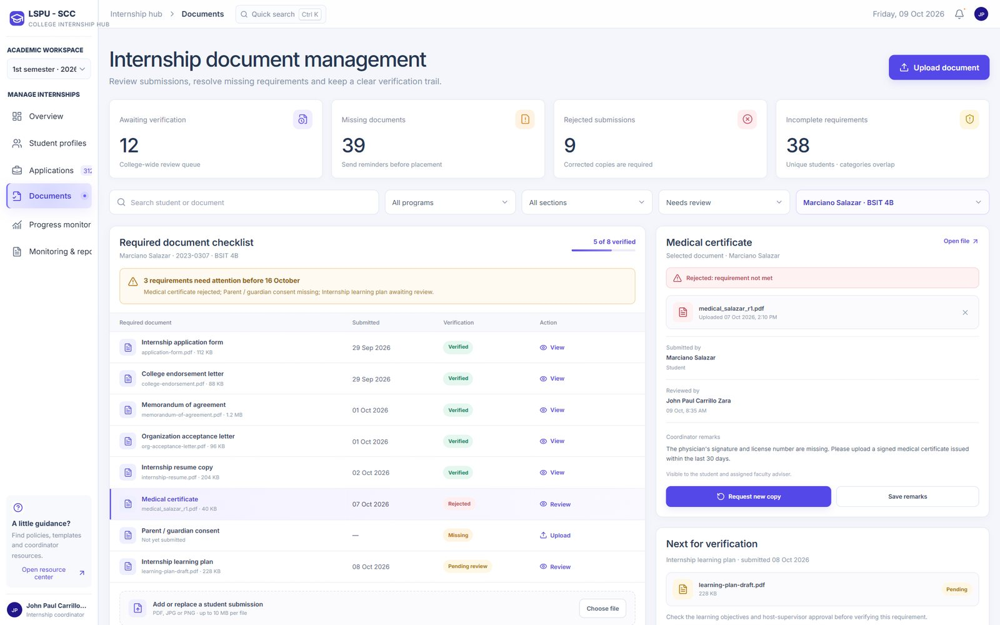

# College Internship Hub

An internship monitoring and management workspace for internship coordinators at **LSPU-SCC**: placements, applications, required documents, and rendered hours in one place.

> **Status:** front-end prototype running on sample data. The backend (`backend/`) hasn't been started yet, and the demo sign-in doesn't authenticate.



## Features

- **Overview**: a placement pipeline (not applied, applying, accepted, interning, completed) where each segment filters the application register, plus the students who need follow-up.
- **Student profiles** and an **application register** with search, filters, pagination, and CSV export of exactly the rows you filtered.
- **Document verification** with a per-student requirements checklist and coordinator remarks.
- **Progress monitoring** with rendered hours, attendance logs, weekly accomplishments, and adviser remarks.
- **Keyboard friendly**: quick search on <kbd>Ctrl</kbd> + <kbd>K</kbd>, and <kbd>Esc</kbd> closes any dialog.

| Progress monitoring | Document verification |
|---|---|
|  |  |

## Tech

React · TypeScript · Vite · lucide-react

## Run it locally

Requires Node.js 18+.

```bash
cd frontend
npm install
npm run dev        # http://localhost:5173
```

On the sign-in screen, choose **Admin**, enter any ID and password, and you'll land on the coordinator dashboard (demo only).

```bash
npm run build      # type-check and build to frontend/dist
```

All names, organizations, and figures in the prototype are sample data.

---

Built by [Karl Cuerdo](https://github.com/choivxcz).
